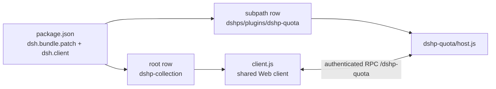

<!-- markdownlint-disable MD033 MD041 -->
# dshps: DSH plugin stack

<p align="center">
  <a href="https://github.com/Amwidtf/dshps/actions/workflows/ci.yml"></a>
  <a href="LICENSE"></a>
  <a href="package.json"></a>
  
  <a href="README.md"></a>
</p>

[简体中文](README.md) | **English**

Repository: <https://github.com/Amwidtf/dshps>

dshps is a DSH plugin stack: one bundle with several `dshp-` plugins that share a Web client bundle and a settings page. Each plugin keeps its own Host half and documentation, and can be installed, disabled or upgraded on its own.

This README covers the stack: install, included plugins and repository layout. Display details, options and known issues for a single plugin live in that plugin's README.

## Table of contents

- [Plugins](#plugins)
- [What the stack provides](#what-the-stack-provides)
- [Install](#install)
- [Settings](#settings)
- [Compatibility](#compatibility)
- [Privacy & security](#privacy--security)
- [Architecture](#architecture)
- [Development & testing](#development--testing)
- [Adding a plugin](#adding-a-plugin)
- [FAQ](#faq)
- [Disclaimer](#disclaimer)
- [License](#license)

## Plugins

| Plugin | Purpose | Docs | Status |
|---|---|---|---|
| `dshp-quota` | Sidebar balance and quota panel for DeepSeek, Kimi, MiniMax and Zhipu GLM | [plugins/dshp-quota/README.en.md](plugins/dshp-quota/README.en.md) · [中文](plugins/dshp-quota/README.md) | Bundled |

Add a row here when a plugin is added. Put the details in `plugins/dshp-*/README.md`, not in the root README.

## What the stack provides

- **One bundle, several plugins**: `cordis.patch.yml` inserts multiple rows. The root row mounts the shared Web client; subpath rows run Host halves only.
- **Shared Web client**: every `dshp-*` UI registers in one `client.js`. A package has exactly one `./client` export.
- **One settings entry**: the stack settings page lives under Settings → DSH Plugin Stack. Plugin options are rendered there and apply live.
- **Naming and metadata**: plugin folders, RPC channels, locale files and icons follow the `dshp-*` convention. Subpath plugin titles and descriptions come from the parent package `exports`.
- **Independent credentials**: each plugin resolves credentials through `ctx.credentials` inside its own Host half. Credentials stay in the Host process; the browser never sees them.

## Install

You need a DSH version that supports Cordis bundle patches and `dsh.bundle` / `dsh.client`.

1. Clone or download this repository: `git clone https://github.com/Amwidtf/dshps.git`.
2. Install the repository directory through DSH's bundle installer, for example `plugin_manager`'s `install_bundle`, or the plugin installation entry in your DSH client.
3. Refresh the Harness page. Enabled plugins appear where they belong; `dshp-quota` sits at the bottom of the sidebar, above the user row.
4. Open Settings → DSH Plugin Stack to review plugin options. Most setups need no changes.

If a new client bundle does not load after an upgrade, restart DSH as prompted.

## Settings

Settings → DSH Plugin Stack is the stack-level settings page. It currently renders the `dshp-quota` options:

- Zhipu GLM team parameters (organisation, project, type)
- refresh interval
- Kimi web `refresh_token`

See [`plugins/dshp-quota/README.en.md`](plugins/dshp-quota/README.en.md#configuration) for meaning, storage and troubleshooting.

## Compatibility

- DSH must support `dsh.bundle.patch`, `dsh.client` and subpath `exports`.
- Plugins use React, Cordis and the Connection RPC provided by DSH; they ship no runtime dependencies.
- Local tests need Node.js 20 or newer; the repository is verified on Node 24.
- The DPAPI storage for the Kimi web token is Windows-only. Other platforms fall back to DSH's credential service or an environment variable.

## Privacy & security

- The repository has no API keys, cookies, session tokens, account names or personal paths. Test fixtures use fake values.
- Credentials are resolved and used only inside the Host process. They are not logged or sent to the browser.
- The Kimi `refresh_token` is DPAPI-encrypted in the local user profile, or kept in DSH's local credential store. It is not part of the repository or plugin configuration.
- Local developer tools read credentials only on the machine that runs them, mask secrets and upload nothing.
- Report vulnerabilities privately as described in [SECURITY.md](SECURITY.md). Do not attach real account data or screenshots with balances.

## Architecture



```text
dshps/
├─ package.json            # bundle manifest: dsh.bundle.patch + dsh.client + exports
├─ cordis.patch.yml        # several plugin rows in one bundle
├─ index.js                # stack root Host half, mounts the shared Web client
├─ client.js               # shared Web client bundle: all dshp-* UI
├─ locale/ icon.svg        # stack display metadata
├─ plugins/
│  └─ dshp-quota/
│     ├─ host.js           # plugin Host half
│     ├─ README.md         # plugin docs (Chinese)
│     ├─ README.en.md      # plugin docs (English)
│     ├─ locale/*.json     # plugin row title and description
│     └─ icon.svg
├─ tools/                  # local tests and probes, not installed with plugins
├─ .github/                # CI, issue/PR templates, Copilot rules
├─ research/               # API and DSH notes
├─ README.md               # Chinese README
├─ LICENSE                 # MIT
├─ SECURITY.md
└─ CONTRIBUTING.md
```

## Development & testing

```bash
# Extract Host-test shims from a local DSH install
DSH_ASAR=/path/to/Harness/resources/app.asar npm run setup:test-deps

npm run check      # syntax checks
npm run hygiene    # personal paths and real-looking secrets scan
npm run docs:check # README links and anchors
npm test           # host 20 + client 7, all offline fixtures
```

- `tools/test-host.mjs`: Host-half fixture tests. Currently covers `dshp-quota` provider discovery, adapters, caching, redaction, failure degradation and the authenticated RPC.
- `tools/test-client.mjs`: renders the client bundle with a minimal React/VM harness. Checks slot registration, compact rows, overview, detail, settings page and error boundary.
- `tools/probe-*.mjs`: local probes. `probe-rpc.mjs` calls the installed plugin's RPC (`DSH_WEB_ORIGIN` overrides the default address); `probe-vendors.mjs` prints raw vendor responses; `probe-kimi-web.mjs` diagnoses the Kimi web membership endpoint.
- `tools/asar.mjs`: reads files from DSH's `app.asar`.

When you add a plugin, add its tests to these files or add a dedicated test file and wire it into `npm test`.

## Adding a plugin

1. Create `plugins/dshp-xxx/` with `host.js`, `locale/*.json`, `icon.svg` and `README.md` (plus `README.en.md` when needed).
2. Add `./plugins/dshp-xxx`, `./plugins/dshp-xxx/locale/*.json` and `./plugins/dshp-xxx/icon` to `package.json` `exports`.
3. Add `{ id: dshp-xxx, name: dshps/plugins/dshp-xxx }` to `cordis.patch.yml`.
4. Register the UI in `client.js`. Host data goes through `ctx.connection.rpc.handle('<channel>', ...)`; the client calls `ctx.connection.rpc.call(...)`.
5. For editable options, export a Schemastery `Config` from the Host half, mark fields `volatile` and add them to the settings page.
6. Add a row to the root README plugin table and put details in the plugin README.

## FAQ

**No panel appears**: check that the bundle is installed and the plugin row is active, then refresh the page or restart DSH as prompted.

**Settings page is blank**: refresh and reopen. The page has an error boundary and shows the error instead of an empty card.

**Disable one plugin**: disable its `dshp-*` row in DSH. Other plugins keep running.

**One plugin fails to query**: see that plugin's README troubleshooting first. Common causes are a missing provider, a key for the wrong route, or a changed vendor endpoint.

## Disclaimer

This is an unofficial third-party DSH plugin stack, not affiliated with or endorsed by DeepSeek, Kimi (Moonshot AI), MiniMax or Zhipu GLM. Vendor endpoints are non-public and may change. Plugins only read balance, quota and subscription usage for display; they do not place transactions or change account state. Check the terms of the services you use.

## License

[MIT](LICENSE) © 2026 dshps contributors
