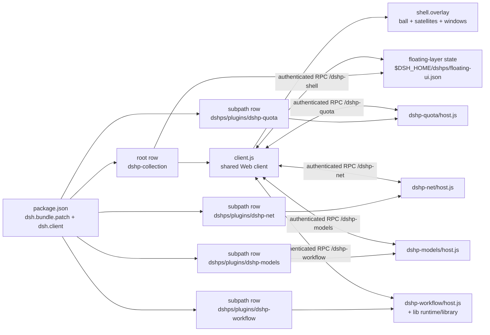

<!-- markdownlint-disable MD033 MD041 -->
# dshps: DSH plugin stack

<p align="center">
  <a href="https://github.com/Amwidtf/dshps/actions/workflows/ci.yml"></a>
  <a href="LICENSE"></a>
  <a href="package.json"></a>
  
  <a href="README.md"></a>
</p>

[简体中文](README.md) | **English**

Repository: <https://github.com/Amwidtf/dshps>

dshps is a DSH plugin stack: one bundle with several `dshp-` plugins that share a Web client bundle and a settings page. Each plugin keeps its own Host half and documentation, and can be installed, disabled or upgraded on its own.

The stack currently covers four capabilities: balance/quota panels (`dshp-quota`), a network proxy with per-provider routing and an audit monitor (`dshp-net`), model sign-in (`dshp-models`) that wires the official Sign in with ChatGPT flow into the `openai` route and surfaces the existing authorization flows, and workflow enhancements (`dshp-workflow`) with saved, observable and resumable dynamic workflows. The shared Web client also ships a **dshps floating layer**: a draggable ball with a satellite ring and movable/resizable/collapsible/lockable floating windows (network monitor, audit log, quota overview, sign-in status) whose geometry and switches persist.

This README covers the stack: install, included plugins and repository layout. Display details, options and known issues for a single plugin live in that plugin's README.

## Table of contents

- [Plugins](#plugins)
- [What the stack provides](#what-the-stack-provides)
- [Install](#install)
- [Settings](#settings)
- [Compatibility](#compatibility)
- [Privacy & security](#privacy--security)
- [Architecture](#architecture)
- [Development & testing](#development--testing)
- [Adding a plugin](#adding-a-plugin)
- [FAQ](#faq)
- [Disclaimer](#disclaimer)
- [License](#license)

## Plugins

| Plugin | Purpose | Docs | Status |
|---|---|---|---|
| `dshp-quota` | Sidebar balance and quota panel for DeepSeek, Kimi, MiniMax and Zhipu GLM | [plugins/dshp-quota/README.en.md](plugins/dshp-quota/README.en.md) · [中文](plugins/dshp-quota/README.md) | Bundled |
| `dshp-net` | Local routing proxy: multiple proxies, per-provider/domain routing, one-time `.env` bootstrap, audit monitor (network-monitor / audit-log floating windows) | [plugins/dshp-net/README.en.md](plugins/dshp-net/README.en.md) · [中文](plugins/dshp-net/README.md) | Bundled |
| `dshp-models` | Model sign-in: official Sign in with ChatGPT flow wired into the `openai` route, plus UI for the existing authorization flows | [plugins/dshp-models/README.en.md](plugins/dshp-models/README.en.md) · [中文](plugins/dshp-models/README.md) | Bundled |
| `dshp-workflow` | Workflow enhancements: saved, observable and resumable dynamic workflows with read-only files/git, world.run command gates, a journal, resume/amend and budget caps | [plugins/dshp-workflow/README.en.md](plugins/dshp-workflow/README.en.md) · [中文](plugins/dshp-workflow/README.md) | Bundled |

Add a row here when a plugin is added. Put the details in `plugins/dshp-*/README.md`, not in the root README.

## What the stack provides

- **One bundle, several plugins**: `cordis.patch.yml` inserts multiple rows. The root row mounts the shared Web client; subpath rows run Host halves only.
- **Shared Web client**: every `dshp-*` UI registers in one `client.js`. A package has exactly one `./client` export.
- **One settings entry**: the stack settings page lives under Settings → DSH Plugin Stack, with Balance / Network / Sign-in / Workflow / Floating tabs. Plugin options are rendered there and apply live.
- **Draggable floating layer**: a dshps ball in `shell.overlay` moves anywhere in the page and stays where it is dropped; hovering it reveals a hide button (top-right) and a quick lock button (bottom-right); a locked ball still opens the ring, and hiding keeps open windows while the ball can be re-enabled in Settings. Clicking opens the satellites as one smooth, equal-radius, evenly-spaced arc (like a phone's floating-ball satellite menu). The available angle follows the ball's distance to the edges: a full 360° circle in open space, an inward-facing 180° half arc against one edge, and an inward 90° quarter arc in a corner. The arc radius grows automatically to keep a gap between balls (roughly 123px for four balls in a corner). Only when a single arc cannot fit do outer concentric arcs appear (still evenly spaced per ring); a tiny viewport falls back to a compact grid. Every ball stays inside the viewport and none overlap. Each satellite toggles its floating window; windows start unlocked and can be dragged, resized, collapsed, locked, raised and closed — locking only restricts moving/resizing/closing, never in-window actions, and reset restores the unlocked defaults. The quota overview reuses the bottom-left quota panel's compact content/style and defaults to the bottom-left corner. Geometry and switches persist in `$DSH_HOME/dshps/floating-ui.json` across refreshes and restarts. Windows, the ball and popovers use DSH theme tokens (surface/border/text/state) and follow the light/dark theme; the active window no longer keeps a highlighted border.
- **Controllable egress**: `dshp-net` runs a loopback routing proxy and forwards by target host to an upstream proxy or direct. The first activation writes `$DSH_HOME/.env` once and needs one DSH restart; afterwards proxy and routing edits apply immediately.
- **Observability**: `dshp-net` records requests, failures, latency and bytes through the gateway; the settings page shows statistics and an audit log, and the dshps floating ball opens live “Network monitor” and “Audit log” windows.
- **Sign-in support**: `dshp-models` writes the official Sign in with ChatGPT OAuth credential back to the `llm-pi-ai/openai` record and surfaces DSH's registered authorization flows in the UI. Tokens stay in the Host process.
- **Reusable workflows**: `dshp-workflow` saves named workflows in the workspace; the model runs them through the `workflow_plus` tool or `/workflow run <id>`. Scripts can fan out subagents, observe `files`/`git`, and run allowlisted deterministic commands after an explicit grant; a run journal supports resume/amend. Execute and ad-hoc scripts are off by default, and execute grants bind to the workflow content hash.
- **Naming and metadata**: plugin folders, RPC channels, locale files and icons follow the `dshp-*` convention. Subpath plugin titles and descriptions come from the parent package `exports`.
- **Independent credentials**: each plugin resolves credentials through `ctx.credentials` inside its own Host half. Credentials stay in the Host process; the browser never sees them. Proxy passwords live in credential records, not plugin configuration.

## Install

You need a DSH version that supports Cordis bundle patches and `dsh.bundle` / `dsh.client`.

1. Clone or download this repository: `git clone https://github.com/Amwidtf/dshps.git`.
2. Install the repository directory through DSH's bundle installer, for example `plugin_manager`'s `install_bundle`, or the plugin installation entry in your DSH client.
3. Refresh the Harness page. Enabled plugins appear where they belong; `dshp-quota` sits at the bottom of the sidebar, above the user row, and the dshps floating ball appears at the bottom-right (switchable from Settings).
4. Open Settings → DSH Plugin Stack to review plugin options. Most setups need no changes.

If a new client bundle does not load after an upgrade, restart DSH as prompted.

## Settings

Settings → DSH Plugin Stack is the stack-level settings page with five tabs:

- **Balance**: `dshp-quota` options — Zhipu GLM team parameters (organisation, project, type), refresh interval, Kimi web `refresh_token`.
- **Network**: the `dshp-net` proxy list (one row per proxy; provider tags inside each row mean that provider goes through the proxy, and providers in no proxy tag stay direct), listen port (default 17890, editable in Settings), default egress, `.env` apply/revert, effectiveness test, statistics and audit log. “Add provider” opens a searchable picker; a provider already assigned elsewhere moves automatically. Click a provider tag to add auth/callback domains, × removes the routing, and each proxy row shows health and latency. An occupied port falls back automatically; saving a port change rewrites a managed `.env` and asks for a full restart, while other proxy/routing edits apply immediately (the first activation still needs one full DSH restart).
- **Sign-in**: `dshp-models` Sign in with ChatGPT status and sign-in/out, the openai route creation entry, other providers' authorization flows, and prompt/code/select inputs.
- **Workflow**: `dshp-workflow` engine switches, limits, safety policy, global workflow library and run history; runs start through `/workflow run` or the `workflow_plus` tool. Execute and ad-hoc scripts are off by default, and execute grants bind to the workflow content hash (`id@sha256`).
- **Floating**: enable/disable the dshps floating ball, lock its position, choose which satellite windows appear in the ring, and reset all geometry and state. Hovering the ball also reveals hide (top-right) and lock (bottom-right) controls.

Floating-ball and window geometry, collapse/lock/stack state, switches and satellite visibility persist in `$DSH_HOME/dshps/floating-ui.json` (UI state only, no credentials) and survive refreshes and restarts. A window's lock restricts moving, resizing and closing only; its content buttons keep working.

Every settings section is collapsible and collapsed by default. The network tab is organized proxy-first: one row per proxy with its provider tags (everything is direct by default; unassigned providers appear in no proxy tag), selects use DSH-style popovers, and sign-in providers are added through an “Add sign-in” button rather than a permanent list.

UI copy registers zh/en dictionaries through DSH `ctx.locale.register` and follows Settings → General immediately; plugin display names/descriptions use each plugin's `locale/{zh,en}.json`. Host-generated environment warnings return stable `code + params` (the English `warning` string is only a fallback) and are localized by the client, so a Chinese UI never shows a long English warning.

See the plugin READMEs for meaning, storage and troubleshooting:

- [`plugins/dshp-quota/README.en.md`](plugins/dshp-quota/README.en.md#configuration)
- [`plugins/dshp-net/README.en.md`](plugins/dshp-net/README.en.md#configuration)
- [`plugins/dshp-models/README.en.md`](plugins/dshp-models/README.en.md#configuration)
- [`plugins/dshp-workflow/README.en.md`](plugins/dshp-workflow/README.en.md#settings)

`dshp-net` writes `HTTP_PROXY` / `HTTPS_PROXY` into `$DSH_HOME/.env` pointing at its loopback gateway, and restores the previous values on revert. DSH reads that file at launch, so both apply and revert need one DSH restart.

## Compatibility

- DSH must support `dsh.bundle.patch`, `dsh.client` and subpath `exports`.
- Plugins use React, Cordis and the Connection RPC provided by DSH; they ship no runtime dependencies.
- Local tests need Node.js 20 or newer; the repository is verified on Node 24.
- The DPAPI storage for the Kimi web token is Windows-only. Other platforms fall back to DSH's credential service or an environment variable.

## Privacy & security

- The repository has no API keys, cookies, session tokens, account names or personal paths. Test fixtures use fake values.
- Credentials are resolved and used only inside the Host process. They are not logged or sent to the browser.
- The Kimi `refresh_token` is DPAPI-encrypted in the local user profile, or kept in DSH's local credential store. It is not part of the repository or plugin configuration.
- Local developer tools read credentials only on the machine that runs them, mask secrets and upload nothing.
- Proxy passwords, ChatGPT OAuth tokens and similar secrets go through DSH's credential service; they never appear in plugin configuration, logs or RPC results.
- `dshp-net` listens on `127.0.0.1` only and validates a local gateway token. Taking over egress requires an explicit `.env` write plus a restart; revert `.env` before disabling or removing the plugin (the settings page offers a one-click revert).
- `dshp-models` uses OpenAI's official Sign in with ChatGPT OAuth flow. Tokens serve model requests on the `openai` route, and usage is bounded by the ChatGPT plan and OpenAI's terms.
- The floating-layer state file `$DSH_HOME/dshps/floating-ui.json` stores only ball/window geometry and switches, never credentials; the root Host writes it atomically and the browser accesses it through the authenticated RPC.
- Report vulnerabilities privately as described in [SECURITY.md](SECURITY.md). Do not attach real account data or screenshots with balances.

## Architecture



```text
dshps/
├─ package.json            # bundle manifest: dsh.bundle.patch + dsh.client + exports
├─ cordis.patch.yml        # several plugin rows in one bundle
├─ index.js                # root Host half: shared Web client + floating-layer state
├─ client.js               # shared Web client bundle: quota panel, settings, floating UI
├─ locale/ icon.svg        # stack display metadata
├─ plugins/
│  ├─ dshp-quota/
│  │  ├─ host.js           # plugin Host half
│  │  ├─ README.md         # plugin docs (Chinese)
│  │  ├─ README.en.md      # plugin docs (English)
│  │  ├─ locale/*.json     # plugin row title and description
│  │  └─ icon.svg
│  ├─ dshp-net/
│  │  ├─ host.js           # routing proxy, .env bootstrap, audit monitor
│  │  ├─ README.md / README.en.md
│  │  ├─ locale/*.json
│  │  └─ icon.svg
│  ├─ dshp-models/
│  │  ├─ host.js           # ChatGPT OAuth + authorization-flow bridge
│  │  ├─ README.md / README.en.md
│  │  ├─ locale/*.json
│  │  └─ icon.svg
│  └─ dshp-workflow/
│     ├─ host.js           # workflow tool/command/RPC/settings
│     ├─ lib/              # meta parsing, library + run journal, extended runtime
│     ├─ README.md / README.en.md
│     ├─ locale/*.json
│     └─ icon.svg
├─ tools/                  # local tests and probes, not installed with plugins
├─ .github/                # CI, issue/PR templates, Copilot rules
├─ research/               # API and DSH notes
├─ README.md               # Chinese README
├─ LICENSE                 # MIT
├─ SECURITY.md
└─ CONTRIBUTING.md
```

## Development & testing

```bash
# Extract Host-test shims from a local DSH install
DSH_ASAR=/path/to/Harness/resources/app.asar npm run setup:test-deps

npm run check      # syntax checks
npm run hygiene    # personal paths and real-looking secrets scan
npm run docs:check # README links and anchors
npm test           # host + workflow + client offline fixtures
```

- `tools/test-host.mjs`: Host-half fixture tests. Covers `dshp-quota` provider discovery, adapters, caching, redaction and failure degradation, the pure logic and RPC behaviour of `dshp-net` and `dshp-models`, `dshp-workflow` plugin/RPC/tool/command and execute-grant behaviour, and the root Host's floating-layer validation/persistence/conflict handling.
- `tools/test-workflow.mjs`: offline runtime/library/meta tests for `dshp-workflow`: hook semantics, structured results, `files`/`git`/`world.run`, budgets, cancellation, resume/amend caches and failure classification.
- `tools/test-client.mjs`: renders the client bundle with a minimal React/VM harness. Checks slot registration, compact rows, overview, detail, the five settings tabs (including Workflow), the floating ball/satellites/windows, collapse and viewport clamping, and the error boundary.
- `tools/probe-*.mjs`: local probes. `probe-rpc.mjs` calls the installed plugin's RPC (`DSH_WEB_ORIGIN` overrides the default address); `probe-vendors.mjs` prints raw vendor responses; `probe-kimi-web.mjs` diagnoses the Kimi web membership endpoint.
- `tools/asar.mjs`: reads files from DSH's `app.asar`.

When you add a plugin, add its tests to these files or add a dedicated test file and wire it into `npm test`.

## Adding a plugin

1. Create `plugins/dshp-xxx/` with `host.js`, `locale/*.json`, `icon.svg` and `README.md` (plus `README.en.md` when needed).
2. Add `./plugins/dshp-xxx`, `./plugins/dshp-xxx/locale/*.json` and `./plugins/dshp-xxx/icon` to `package.json` `exports`.
3. Add `{ id: dshp-xxx, name: dshps/plugins/dshp-xxx }` to `cordis.patch.yml`.
4. Register the UI in `client.js`. Host data goes through `ctx.connection.rpc.handle('<channel>', ...)`; the client calls `ctx.connection.rpc.call(...)`.
5. For editable options, export a Schemastery `Config` from the Host half, mark fields `volatile` and add them to the settings page.
6. Add a row to the root README plugin table and put details in the plugin README.

## FAQ

**No panel appears**: check that the bundle is installed and the plugin row is active, then refresh the page or restart DSH as prompted.

**Settings page is blank**: refresh and reopen. The page has an error boundary and shows the error instead of an empty card.

**Disable one plugin**: disable its `dshp-*` row in DSH. Other plugins keep running.

**One plugin fails to query**: see that plugin's README troubleshooting first. Common causes are a missing provider, a key for the wrong route, or a changed vendor endpoint.

**Proxy change has no effect**: the first `.env` apply and every revert need a full DSH restart; a system-level `HTTPS_PROXY` overrides the file and must be cleared. The settings page's effectiveness test reports which case applies.

**ChatGPT sign-in fails**: make sure the `openai` route exists and has no API key (a key overrides OAuth), that the machine can reach `auth.openai.com` (configure a proxy in `dshp-net` first if needed), and that callback port `1455` is free. If the browser callback does not arrive, paste the final redirect URL into the settings page.

**No network after disabling the gateway**: `.env` still points at the stopped loopback gateway. Re-enable `dshp-net`, or use Revert `.env` in its settings and restart DSH.

**The floating ball disappeared or moved somewhere odd**: open Settings → DSH Plugin Stack → Floating and check “Enable the dshps floating ball” and the satellite list; “Reset all positions and state” restores defaults. A position-locked ball still opens the satellite ring — it just cannot be dragged.

**A floating window will not open or is hidden behind another**: make sure its satellite is enabled; click the window title bar or the “Bring to front” button to raise it. A locked window cannot be moved, resized or closed until you unlock it from the title-bar lock button.

**Workflow execution is refused**: `execute` and ad-hoc scripts are off by default. In Settings → DSH Plugin Stack → Workflow, enable `allowExecute`, add the workflow grant as `id@sha256` to `executeAllowlist`, and add the command to `allowedCommands`; changing the saved script invalidates the old grant. Ad-hoc scripts need `allowAdHocScripts`; they execute in the Host process as trusted code, not in a sandbox.

**A workflow child modified files**: `observe`/`execute` constrain script hooks only, not a child's own tools. Set a read-only `childPreset` for observation-only workflows, or state the read-only rule in the child prompt.

## Disclaimer

This is an unofficial third-party DSH plugin stack, not affiliated with or endorsed by DeepSeek, Kimi (Moonshot AI), MiniMax, Zhipu GLM or OpenAI. Vendor endpoints are non-public and may change. Plugins only read balance, quota and subscription usage for display; they do not place transactions or change account state. `dshp-models` uses OpenAI's official Sign in with ChatGPT OAuth flow; model usage is bounded by the ChatGPT plan and OpenAI's terms. Check the terms of the services you use.

## License

[MIT](LICENSE) © 2026 dshps contributors
