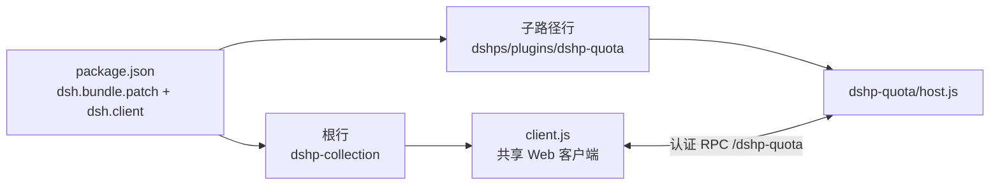

<!-- markdownlint-disable MD033 MD041 -->
# dshps：DSH 插件栈

<p align="center">
  <a href="https://github.com/Amwidtf/dshps/actions/workflows/ci.yml"></a>
  <a href="LICENSE"></a>
  <a href="package.json"></a>
  
  <a href="README.en.md"></a>
</p>

**简体中文** | [English](README.en.md)

仓库：<https://github.com/Amwidtf/dshps>

dshps 是一个 DSH 插件栈：一个 bundle 里放多个以 `dshp-` 开头的插件，共用一份 Web 客户端和设置页。每个插件自己写 Host 半和文档，可以单独安装、停用和升级。

这个 README 讲整个栈：怎么装、包含哪些插件、仓库怎么组织。单个插件的显示细节、配置项和已知问题写在插件自己的 README 里。

## 目录

- [插件列表](#插件列表)
- [栈提供什么](#栈提供什么)
- [安装](#安装)
- [配置入口](#配置入口)
- [兼容性](#兼容性)
- [隐私与安全](#隐私与安全)
- [架构](#架构)
- [开发与测试](#开发与测试)
- [新增插件](#新增插件)
- [常见问题](#常见问题)
- [免责声明](#免责声明)
- [许可](#许可)

## 插件列表

| 插件 | 作用 | 文档 | 状态 |
|---|---|---|---|
| `dshp-quota` | 侧边栏余额与额度面板：DeepSeek、Kimi、MiniMax、智谱 GLM | [plugins/dshp-quota/README.md](plugins/dshp-quota/README.md) · [EN](plugins/dshp-quota/README.en.md) | 随栈提供 |

新增插件后在这里加一行，插件说明写到对应的 `plugins/dshp-*/README.md`，不要堆进根 README。

## 栈提供什么

- **一个 bundle 管多个插件**：`cordis.patch.yml` 一次插入多行；根行挂载共享 Web 客户端，子路径行只跑 Host 半。
- **共享 Web 客户端**：所有 `dshp-*` 的界面注册在同一个 `client.js`，包只允许一个 `./client`。
- **统一设置入口**：栈级设置页在「设置 → DSH 插件栈」，插件自己的配置项也放在这里，保存后实时生效。
- **统一命名和元数据**：插件目录、RPC 通道、locale 文件和图标按 `dshp-*` 约定组织；插件标题和描述由父包 `exports` 提供给子路径行。
- **独立凭据**：每个插件在自己的 Host 半里通过 `ctx.credentials` 取凭据，凭据只留在 Host 进程，浏览器拿不到。

## 安装

需要支持 Cordis bundle patch 和 `dsh.bundle` / `dsh.client` 的 DSH 版本。

1. 克隆或下载这个仓库：`git clone https://github.com/Amwidtf/dshps.git`。
2. 通过 DSH 的 bundle 安装机制安装仓库目录，例如 `plugin_manager` 的 `install_bundle`，或用 DSH 客户端里的插件安装入口。
3. 刷新 Harness 页面。已启用的插件会出现在自己的位置，例如 `dshp-quota` 在侧边栏底部、用户信息上方。
4. 打开「设置 → DSH 插件栈」检查插件配置。多数情况下不用改任何东西。

升级后新的客户端 bundle 没生效时，按 DSH 提示重启一次。

## 配置入口

「设置 → DSH 插件栈」是栈级设置页，当前包含 `dshp-quota` 的配置项：

- 智谱 GLM 团队参数（组织、项目、type）
- 自动刷新间隔
- Kimi 网页 `refresh_token`

具体含义、存储位置和排错见 [`plugins/dshp-quota/README.md`](plugins/dshp-quota/README.md#配置)。

## 兼容性

- 需要支持 `dsh.bundle.patch`、`dsh.client` 和 subpath `exports` 的 DSH 版本。
- 插件运行时依赖 DSH 提供的 React、Cordis 和 Connection RPC，不额外装依赖。
- 跑本地测试需要 Node.js 20 以上；仓库在 Node 24 上验证过。
- Kimi 网页 token 的 DPAPI 存储只在 Windows 上启用，其他平台回退到 DSH 凭据服务或环境变量。

## 隐私与安全

- 仓库里没有 API Key、Cookie、会话 token、账号名和个人路径。测试夹具都是假值。
- 凭据只在 Host 进程内解析和使用，不写日志，不发给浏览器。
- Kimi `refresh_token` 用 Windows DPAPI 加密后放在本机用户目录，或交给 DSH 本地凭据服务，不进入仓库和插件配置。
- 本地调试工具只读取运行它的机器上的凭据，输出会脱敏，不会上传。
- 安全漏洞按 [SECURITY.md](SECURITY.md) 私下报告。不要在 issue 里贴真实账号数据或带余额的截图。

## 架构



```text
dshps/
├─ package.json            # bundle 清单：dsh.bundle.patch + dsh.client + exports
├─ cordis.patch.yml        # 一个 bundle 内插入多个插件行
├─ index.js                # 插件栈根 Host 半，只挂载共享 Web 客户端
├─ client.js               # 共享 Web 客户端 bundle，所有 dshp-* 界面都在这里
├─ locale/ icon.svg        # 插件栈的显示元数据
├─ plugins/
│  └─ dshp-quota/
│     ├─ host.js           # 插件 Host 半
│     ├─ README.md         # 插件说明（中文）
│     ├─ README.en.md      # 插件说明（英文）
│     ├─ locale/*.json     # 插件行标题和描述
│     └─ icon.svg
├─ tools/                  # 本地测试与探针，不随插件安装
├─ .github/                # CI、issue/PR 模板、Copilot 指引
├─ research/               # 接口与 DSH 内部机制调研笔记
├─ README.en.md            # English README
├─ LICENSE                 # MIT
├─ SECURITY.md
└─ CONTRIBUTING.md
```

## 开发与测试

```bash
# 从本机 DSH 安装包提取 Host 测试要用的 @deepseek-ai/schemastery 等依赖
DSH_ASAR=/path/to/Harness/resources/app.asar npm run setup:test-deps

npm run check      # 语法检查
npm run hygiene    # 隐私、密钥、个人路径检查
npm run docs:check # README 链接和锚点检查
npm test           # host 20 项 + client 7 项，全部离线夹具
```

- `tools/test-host.mjs`：Host 半的离线夹具测试，当前覆盖 `dshp-quota` 的供应商发现、适配器、缓存、脱敏、失败降级和认证 RPC。
- `tools/test-client.mjs`：用极简 React/VM 夹具渲染客户端 bundle，检查 slot 注册、折叠行、总览、详情、设置页和错误边界。
- `tools/probe-*.mjs`：本机探针。`probe-rpc.mjs` 调已安装插件的 RPC，`DSH_WEB_ORIGIN` 可覆盖默认地址；`probe-vendors.mjs` 看厂商原始响应；`probe-kimi-web.mjs` 诊断 Kimi 网页会员接口。
- `tools/asar.mjs`：读取 DSH `app.asar` 里的文件。

新增插件时，测试要跟着放在这两个文件里，或者给插件单独建测试文件并在 `npm test` 里串起来。

## 新增插件

1. 建 `plugins/dshp-xxx/`，包含 `host.js`、`locale/*.json`、`icon.svg`、`README.md`（必要时加 `README.en.md`）。
2. 在 `package.json` 的 `exports` 里加 `./plugins/dshp-xxx`、`./plugins/dshp-xxx/locale/*.json`、`./plugins/dshp-xxx/icon`。
3. 在 `cordis.patch.yml` 的 `insert` 列表里加 `{ id: dshp-xxx, name: dshps/plugins/dshp-xxx }`。
4. 在 `client.js` 注册界面。Host 数据走 `ctx.connection.rpc.handle('<channel>', ...)`，客户端用 `ctx.connection.rpc.call('<channel>', endpoint, payload)` 调用。
5. 需要可编辑配置时，Host 半导出 Schemastery `Config`，字段标 `volatile`，设置页加对应字段。
6. 在根 README 的插件表里加一行，把细节写进插件自己的 README。

## 常见问题

**面板没出现**：确认 bundle 已安装、对应插件行处于激活状态，然后刷新页面或按提示重启 DSH。

**设置页空白**：刷新页面再打开。设置页有错误边界，出错会显示原因，不会只剩空白。

**想停用某个插件**：在 DSH 里停用对应的 `dshp-*` 行，其他插件不受影响。

**某个插件查询失败**：先看插件 README 的排错部分；多数是供应商没配置、Key 类型不匹配或接口变化。

## 免责声明

这是第三方 DSH 插件栈，和 DeepSeek、Kimi（月之暗面）、MiniMax、智谱 GLM 官方没有隶属或背书关系。各厂商接口都不是公开接口，字段和可用性可能变化。插件只读取余额、额度、订阅用量用于展示，不代用户交易，也不改账号状态。使用前请确认所在服务的条款。

## 许可

[MIT](LICENSE) © 2026 dshps contributors
