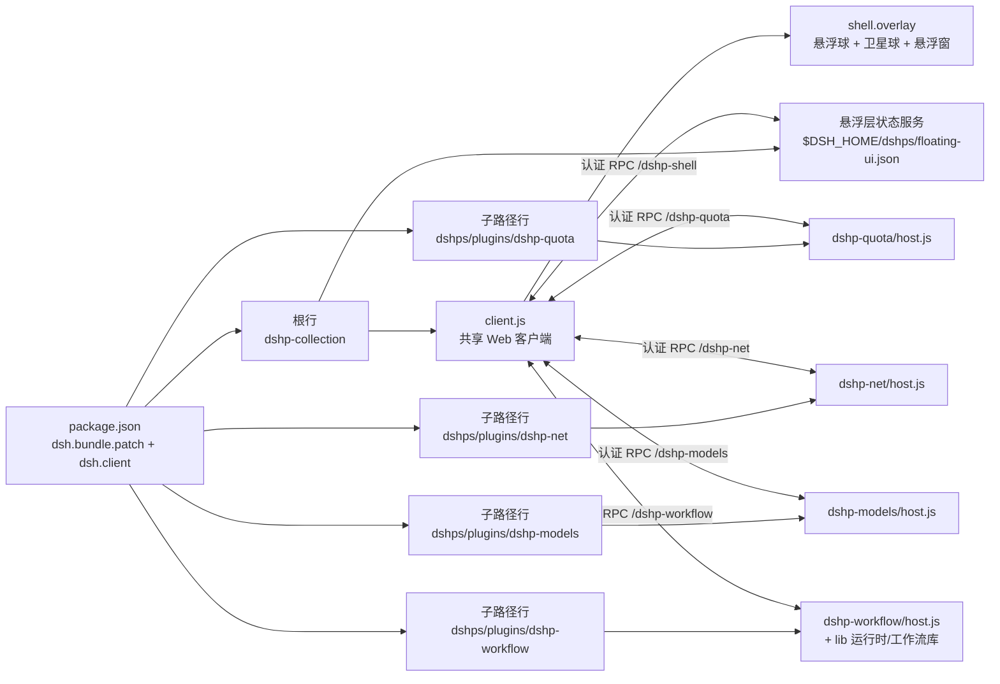

<!-- markdownlint-disable MD033 MD041 -->
# dshps：DSH 插件栈

<p align="center">
  <a href="https://github.com/Amwidtf/dshps/actions/workflows/ci.yml"></a>
  <a href="LICENSE"></a>
  <a href="package.json"></a>
  
  <a href="README.en.md"></a>
</p>

**简体中文** | [English](README.en.md)

仓库：<https://github.com/Amwidtf/dshps>

dshps 是一个 DSH 插件栈：一个 bundle 里放多个以 `dshp-` 开头的插件，共用一份 Web 客户端和设置页。每个插件自己写 Host 半和文档，可以单独安装、停用和升级。

当前包含四类能力：余额/额度面板（`dshp-quota`）、网络代理与按供应商分流（`dshp-net`，含监控审计）、模型登录（`dshp-models`，把官方 Sign in with ChatGPT 流程接到 `openai` 路由，并接出现有 authorization flows 的登录界面），以及工作流增强（`dshp-workflow`：可保存、可观察、可恢复的扩展动态工作流）。栈级 Web 客户端另外提供 **dshps 悬浮层**：可拖拽悬浮球 + 环形卫星球菜单 + 可移动/缩放/收起/锁定/置顶的悬浮窗（网络监控、审计日志、额度总览、登录状态），位置与开关持久化。

这个 README 讲整个栈：怎么装、包含哪些插件、仓库怎么组织。单个插件的显示细节、配置项和已知问题写在插件自己的 README 里。

## 目录

- [插件列表](#插件列表)
- [栈提供什么](#栈提供什么)
- [安装](#安装)
- [配置入口](#配置入口)
- [兼容性](#兼容性)
- [隐私与安全](#隐私与安全)
- [架构](#架构)
- [开发与测试](#开发与测试)
- [新增插件](#新增插件)
- [常见问题](#常见问题)
- [免责声明](#免责声明)
- [许可](#许可)

## 插件列表

| 插件 | 作用 | 文档 | 状态 |
|---|---|---|---|
| `dshp-quota` | 侧边栏余额与额度面板：DeepSeek、Kimi、MiniMax、智谱 GLM | [plugins/dshp-quota/README.md](plugins/dshp-quota/README.md) · [EN](plugins/dshp-quota/README.en.md) | 随栈提供 |
| `dshp-net` | 本地路由代理：多代理、按供应商/域名分流、`.env` 一次性接入、监控审计（网络监控/审计日志悬浮窗） | [plugins/dshp-net/README.md](plugins/dshp-net/README.md) · [EN](plugins/dshp-net/README.en.md) | 随栈提供 |
| `dshp-models` | 模型登录：官方 Sign in with ChatGPT 流程接到 `openai` 路由，并接出现有 authorization flows 的登录界面 | [plugins/dshp-models/README.md](plugins/dshp-models/README.md) · [EN](plugins/dshp-models/README.en.md) | 随栈提供 |
| `dshp-workflow` | 工作流增强：可保存/恢复/观察的扩展动态工作流，支持 files/git 只读、world.run 命令门、journal、resume/amend 与预算上限 | [plugins/dshp-workflow/README.md](plugins/dshp-workflow/README.md) · [EN](plugins/dshp-workflow/README.en.md) | 随栈提供 |

新增插件后在这里加一行，插件说明写到对应的 `plugins/dshp-*/README.md`，不要堆进根 README。

## 栈提供什么

- **一个 bundle 管多个插件**：`cordis.patch.yml` 一次插入多行；根行挂载共享 Web 客户端，子路径行只跑 Host 半。
- **共享 Web 客户端**：所有 `dshp-*` 的界面注册在同一个 `client.js`，包只允许一个 `./client`。
- **统一设置入口**：栈级设置页在「设置 → DSH 插件栈」，分「额度 / 网络代理 / 登录 / 工作流 / 悬浮窗」五个标签；插件自己的配置项也放在这里，保存后实时生效。
- **可拖拽悬浮层**：`shell.overlay` 里的 dshps 悬浮球可在页面内拖动（松手停在拖到的位置）；悬停时右上角出现隐藏按钮、右下角出现快速锁定按钮（锁定后仍可点击展开卫星球），隐藏后窗口保留、可在设置里重新启用。点击展开卫星球，卫星球优先排成**一条等半径、等角度的平滑弧线**（类似手机悬浮球的卫星菜单）：根据悬浮球到四边的相对距离，开阔处用整圈（360°）、贴单边用朝内的半圈（180°）、贴角落用朝自由方向的四分之一圈（90°）；弧线半径会自动放大到球与球之间留出间距（如角落 4 个球约 123px 半径）。只有卫星球多到单弧放不下时，才在外侧增加同心弧（每圈仍等距），极小视口才退化为紧凑网格。所有球都限制在视口内且互不遮盖。每个卫星球打开/隐藏对应的悬浮窗，窗口初始为解锁状态，可拖动、缩放、收起、锁定、置顶和关闭，锁定只限制移动/缩放/关闭、不影响窗口内操作，重置后恢复初始解锁状态。额度总览窗口沿用左下角额度面板的紧凑内容与样式，默认停在左下角。位置/尺寸/开关保存在 `$DSH_HOME/dshps/floating-ui.json`，刷新或重启后恢复。窗口、悬浮球和弹层使用 DSH 主题 token（背景/描边/文字/状态色），跟随深浅色主题；活动窗口不再显示常驻高亮边框。
- **网络出口可控**：`dshp-net` 在本机起一个路由代理，按"供应商/域名 → 上游代理或直连"转发；首次接入写一次 `$DSH_HOME/.env` 并重启 DSH，之后改代理和分流规则即时生效。
- **可观测**：`dshp-net` 记录经过网关的请求、失败、延迟和流量；设置页有统计与审计日志，dshps 悬浮球里可打开「网络监控」与「审计日志」两个实时悬浮窗。
- **登录可接**：`dshp-models` 把官方 Sign in with ChatGPT（OAuth）写回 `llm-pi-ai/openai` 凭据记录，同时把 DSH 已注册的 authorization flows 接到 UI；令牌只留在 Host 进程。
- **工作流可复用**：`dshp-workflow` 在工作区保存命名工作流，模型用 `workflow_plus` 工具或 `/workflow run <id>` 运行；脚本可扇出子代理、只读 `files`/`git`、在显式授权后按命令白名单执行确定性门，运行 journal 支持 resume/amend。执行与临时脚本默认关闭，execute 授权绑定工作流内容哈希。
- **统一命名和元数据**：插件目录、RPC 通道、locale 文件和图标按 `dshp-*` 约定组织；插件标题和描述由父包 `exports` 提供给子路径行。
- **独立凭据**：每个插件在自己的 Host 半里通过 `ctx.credentials` 取凭据，凭据只留在 Host 进程，浏览器拿不到。代理密码保存在凭据记录里，不写进插件配置。

## 安装

需要支持 Cordis bundle patch 和 `dsh.bundle` / `dsh.client` 的 DSH 版本。

1. 克隆或下载这个仓库：`git clone https://github.com/Amwidtf/dshps.git`。
2. 通过 DSH 的 bundle 安装机制安装仓库目录，例如 `plugin_manager` 的 `install_bundle`，或用 DSH 客户端里的插件安装入口。
3. 刷新 Harness 页面。已启用的插件会出现在自己的位置，例如 `dshp-quota` 在侧边栏底部、用户信息上方；页面右下角会出现 dshps 悬浮球（可在设置里关闭）。
4. 打开「设置 → DSH 插件栈」检查插件配置。多数情况下不用改任何东西。

升级后新的客户端 bundle 没生效时，按 DSH 提示重启一次。

## 配置入口

「设置 → DSH 插件栈」是栈级设置页，分五个标签：

- **额度**：`dshp-quota` 的配置——智谱 GLM 团队参数（组织、项目、type）、自动刷新间隔、Kimi 网页 `refresh_token`。
- **网络代理**：`dshp-net` 的代理列表（每个代理一行，行内用标签列出走该代理的供应商；未出现在任何代理标签里的供应商默认直连）、监听端口（默认 17890，可在设置页修改）、默认出口、`.env` 接入/撤销、测试是否生效、统计与审计日志。添加供应商时从可搜索列表选择，已属于其他代理的供应商会自动移动；点供应商标签可补充认证/回调域名，× 取消分流；每个代理行显示健康状态与延迟。端口被占用会自动避让，保存端口时会自动重写已接管的 `.env` 并提示完整重启；其余代理和规则修改即时生效（首次接入仍需完整重启一次）。
- **登录**：`dshp-models` 的 Sign in with ChatGPT 状态与登录/退出、openai 路由创建入口、其他供应商的 authorization flows 登录、提示码/选择项输入。
- **工作流**：`dshp-workflow` 的引擎开关、限额、安全策略、全局工作流库和运行历史；运行由 `/workflow run` 或 `workflow_plus` 工具发起。`execute` 与临时脚本默认关闭，授权按 `id@sha256` 绑定工作流内容。
- **悬浮窗**：启用/关闭 dshps 悬浮球、锁定悬浮球位置、选择环形菜单里显示哪些卫星球、一键重置所有位置与状态。悬浮球悬停时也可以直接右上角隐藏、右下角锁定。

悬浮球与悬浮窗的位置、尺寸、收起/锁定/置顶层级、开关和卫星球可见性保存在 `$DSH_HOME/dshps/floating-ui.json`（纯 UI 状态，不含凭据），刷新或重启后恢复；窗口标题栏的「锁定」只限制移动、缩放和关闭，不影响窗口内按钮操作。

设置页的每个配置区块都可以收起/展开，默认收起；网络代理按"代理列表"组织：每个代理一行，供应商以标签形式挂在代理下（默认全部直连，未分配的不出现在任何代理标签里），下拉选择使用与 DSH 一致的弹层样式；登录用「添加登录」按钮按供应商添加，而不是常驻列表。

界面文案通过 DSH 的 `ctx.locale.register` 注册 zh/en 字典，跟随「设置 → 通用设置」的语言即时切换；插件显示名/描述使用各自的 `locale/{zh,en}.json`。宿主产生的环境警告以稳定 `code + params` 返回（英文 `warning` 仅作兜底），由客户端本地化后展示，因此不会在中文界面里出现英文长警告。

具体含义、存储位置和排错见各插件 README：

- [`plugins/dshp-quota/README.md`](plugins/dshp-quota/README.md#配置)
- [`plugins/dshp-net/README.md`](plugins/dshp-net/README.md#配置)
- [`plugins/dshp-models/README.md`](plugins/dshp-models/README.md#配置)
- [`plugins/dshp-workflow/README.md`](plugins/dshp-workflow/README.md#设置页)

`dshp-net` 会把 `HTTP_PROXY` / `HTTPS_PROXY` 写入 `$DSH_HOME/.env` 指向本机网关；撤销时恢复原值。该文件是 DSH 启动时读取的代理来源，所以接入/撤销后都需要重启一次 DSH。

## 兼容性

- 需要支持 `dsh.bundle.patch`、`dsh.client` 和 subpath `exports` 的 DSH 版本。
- 插件运行时依赖 DSH 提供的 React、Cordis 和 Connection RPC，不额外装依赖。
- 跑本地测试需要 Node.js 20 以上；仓库在 Node 24 上验证过。
- Kimi 网页 token 的 DPAPI 存储只在 Windows 上启用，其他平台回退到 DSH 凭据服务或环境变量。

## 隐私与安全

- 仓库里没有 API Key、Cookie、会话 token、账号名和个人路径。测试夹具都是假值。
- 凭据只在 Host 进程内解析和使用，不写日志，不发给浏览器。
- Kimi `refresh_token` 用 Windows DPAPI 加密后放在本机用户目录，或交给 DSH 本地凭据服务，不进入仓库和插件配置。
- 本地调试工具只读取运行它的机器上的凭据，输出会脱敏，不会上传。
- 代理密码、ChatGPT OAuth 令牌等敏感值只通过 DSH 凭据服务存储和解析，不出现在插件配置、日志或 RPC 返回值中。
- `dshp-net` 只监听 `127.0.0.1`，并校验本地网关口令；它接管出站流量前需要用户显式写入 `.env` 并重启，禁用/卸载插件前应先撤销 `.env`（插件设置页提供一键撤销）。
- `dshp-models` 使用 OpenAI 官方的 Sign in with ChatGPT OAuth 流程；令牌用于 `openai` 路由的模型请求，插件的使用受 ChatGPT 套餐额度与官方条款约束。
- 悬浮层状态文件 `$DSH_HOME/dshps/floating-ui.json` 只保存悬浮球/悬浮窗的几何与开关，不含凭据；由根 Host 半原子写入，浏览器侧通过认证 RPC 读写。
- 安全漏洞按 [SECURITY.md](SECURITY.md) 私下报告。不要在 issue 里贴真实账号数据或带余额的截图。

## 架构



```text
dshps/
├─ package.json            # bundle 清单：dsh.bundle.patch + dsh.client + exports
├─ cordis.patch.yml        # 一个 bundle 内插入多个插件行
├─ index.js                # 根 Host 半：挂载共享 Web 客户端 + 悬浮层状态服务
├─ client.js               # 共享 Web 客户端 bundle：额度面板、设置页、悬浮层 UI
├─ locale/ icon.svg        # 插件栈的显示元数据
├─ plugins/
│  ├─ dshp-quota/
│  │  ├─ host.js           # 插件 Host 半
│  │  ├─ README.md         # 插件说明（中文）
│  │  ├─ README.en.md      # 插件说明（英文）
│  │  ├─ locale/*.json     # 插件行标题和描述
│  │  └─ icon.svg
│  ├─ dshp-net/
│  │  ├─ host.js           # 本地路由代理、.env 接入、监控审计
│  │  ├─ README.md / README.en.md
│  │  ├─ locale/*.json
│  │  └─ icon.svg
│  ├─ dshp-models/
│  │  ├─ host.js           # ChatGPT OAuth + authorization flows 桥接
│  │  ├─ README.md / README.en.md
│  │  ├─ locale/*.json
│  │  └─ icon.svg
│  └─ dshp-workflow/
│     ├─ host.js           # 工作流工具/命令/RPC/设置
│     ├─ lib/              # meta 解析、工作流库与运行 journal、扩展运行时
│     ├─ README.md / README.en.md
│     ├─ locale/*.json
│     └─ icon.svg
├─ tools/                  # 本地测试与探针，不随插件安装
├─ .github/                # CI、issue/PR 模板、Copilot 指引
├─ research/               # 接口与 DSH 内部机制调研笔记
├─ README.en.md            # English README
├─ LICENSE                 # MIT
├─ SECURITY.md
└─ CONTRIBUTING.md
```

## 开发与测试

```bash
# 从本机 DSH 安装包提取 Host 测试要用的 @deepseek-ai/schemastery 等依赖
DSH_ASAR=/path/to/Harness/resources/app.asar npm run setup:test-deps

npm run check      # 语法检查（四个 Host 半 + dshp-workflow lib + client）
npm run hygiene    # 隐私、密钥、个人路径检查
npm run docs:check # README 链接和锚点检查
npm test           # host + client 离线夹具
```

- `tools/test-host.mjs`：Host 半的离线夹具测试，覆盖 `dshp-quota` 的供应商发现/适配器/缓存/脱敏/失败降级，`dshp-net`、`dshp-models` 的纯逻辑与 RPC 行为，`dshp-workflow` 的插件/RPC/工具/命令与执行授权，以及根 Host 的悬浮层状态校验/持久化/冲突处理。
- `tools/test-workflow.mjs`：`dshp-workflow` 运行时/工作流库/meta 的离线测试，覆盖钩子语义、结构化返回、`files`/`git`/`world.run`、预算、取消、resume/amend 缓存与失败分类。
- `tools/test-client.mjs`：用极简 React/VM 夹具渲染客户端 bundle，检查 slot 注册、折叠行、总览、详情、设置页五个标签（含工作流）、悬浮球/卫星球/悬浮窗渲染、收起与边界夹紧、错误边界。
- `tools/probe-*.mjs`：本机探针。`probe-rpc.mjs` 调已安装插件的 RPC，`DSH_WEB_ORIGIN` 可覆盖默认地址；`probe-vendors.mjs` 看厂商原始响应；`probe-kimi-web.mjs` 诊断 Kimi 网页会员接口。
- `tools/asar.mjs`：读取 DSH `app.asar` 里的文件。

新增插件时，测试要跟着放在这两个文件里，或者给插件单独建测试文件并在 `npm test` 里串起来。

## 新增插件

1. 建 `plugins/dshp-xxx/`，包含 `host.js`、`locale/*.json`、`icon.svg`、`README.md`（必要时加 `README.en.md`）。
2. 在 `package.json` 的 `exports` 里加 `./plugins/dshp-xxx`、`./plugins/dshp-xxx/locale/*.json`、`./plugins/dshp-xxx/icon`。
3. 在 `cordis.patch.yml` 的 `insert` 列表里加 `{ id: dshp-xxx, name: dshps/plugins/dshp-xxx }`。
4. 在 `client.js` 注册界面。Host 数据走 `ctx.connection.rpc.handle('<channel>', ...)`，客户端用 `ctx.connection.rpc.call('<channel>', endpoint, payload)` 调用。
5. 需要可编辑配置时，Host 半导出 Schemastery `Config`，字段标 `volatile`，设置页加对应字段。
6. 在根 README 的插件表里加一行，把细节写进插件自己的 README。

## 常见问题

**面板没出现**：确认 bundle 已安装、对应插件行处于激活状态，然后刷新页面或按提示重启 DSH。

**设置页空白**：刷新页面再打开。设置页有错误边界，出错会显示原因，不会只剩空白。

**想停用某个插件**：在 DSH 里停用对应的 `dshp-*` 行，其他插件不受影响。

**某个插件查询失败**：先看插件 README 的排错部分；多数是供应商没配置、Key 类型不匹配或接口变化。

**改了代理不生效**：`dshp-net` 首次接入或撤销 `.env` 后需要完整重启 DSH；如果系统环境变量里已经有 `HTTPS_PROXY`，它会覆盖 `.env`，需要先清掉。设置页的「测试是否生效」会给出结论。

**ChatGPT 登录失败**：确认 `openai` 路由已创建且没有设置 API Key（会覆盖 OAuth）、本机能访问 `auth.openai.com`（必要时先用 `dshp-net` 配好代理）、回调端口 `1455` 未被其他程序占用；浏览器回调不回来时可以把最终跳转地址粘贴到设置页。

**网关停用后网络不通**：说明 `.env` 还指向已停止的本机网关。重新启用 `dshp-net`，或在设置页点「撤销 .env」后重启 DSH。

**悬浮球不见了 / 位置乱了**：到「设置 → DSH 插件栈 → 悬浮窗」检查「启用 dshps 悬浮球」和「卫星球显示」；点「重置所有位置与状态」可恢复默认位置与开关。悬浮球被锁定位置时仍可点击展开卫星球，只是不能拖动。

**某个悬浮窗点不开或被遮挡**：确认对应卫星球已勾选；点击窗口标题栏或「置于顶层」按钮可把重叠的窗口提到最前；窗口锁定后不能移动/缩放/关闭，先点标题栏的锁图标解锁。

**工作流执行被拒绝**：`execute` 与临时脚本默认关闭。先在「设置 → DSH 插件栈 → 工作流」打开 `allowExecute`，把工作流 id 和内容哈希按 `id@sha256` 加入 `executeAllowlist`，并把命令加入 `allowedCommands`；保存的脚本内容一变，旧授权自动失效。临时脚本需要 `allowAdHocScripts`，它在 Host 进程内执行，视为受信代码，不是沙箱。

**工作流里的子代理改了文件**：`observe`/`execute` 只限制脚本钩子，不限制子代理自己的工具。给观察型工作流设置只读的 `childPreset`，或在提示词里明确禁止修改文件。

## 免责声明

这是第三方 DSH 插件栈，和 DeepSeek、Kimi（月之暗面）、MiniMax、智谱 GLM、OpenAI 官方没有隶属或背书关系。各厂商接口都不是公开接口，字段和可用性可能变化。插件只读取余额、额度、订阅用量用于展示，不代用户交易，也不改账号状态。`dshp-models` 使用 OpenAI 官方的 Sign in with ChatGPT OAuth 流程，模型请求的额度与限制以 ChatGPT 套餐和官方条款为准。使用前请确认所在服务的条款。

## 许可

[MIT](LICENSE) © 2026 dshps contributors
